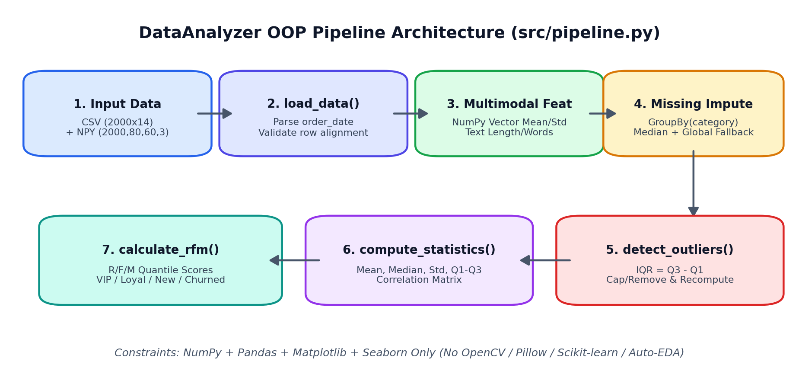

# codyssey-a1-01: 이커머스 멀티모달 데이터 분석 및 RFM 고객 세분화

쇼핑몰에서 누가 자주 오고 많이 사는지 분석해 단골을 찾고, 상품 텍스트·이미지·수치·날짜 멀티모달 데이터를 NumPy/Pandas 기반으로 통합 전처리·시각화하는 프로젝트입니다.

---

## 📊 데이터셋 안내 (출처 및 구성)

본 프로젝트는 공개 라이선스 데이터셋을 기반으로 멀티모달 이커머스 분석 환경을 구성했습니다.

1. **원본 상품 카탈로그 및 이미지 (실제 공개 데이터)**
   * **출처**: Hugging Face [`ashraq/fashion-product-images-small`](https://huggingface.co/datasets/ashraq/fashion-product-images-small) (Kaggle *Fashion Product Images* 기반, 공개 카탈로그)
   * **포함 컬럼**: `product_id`, `product_name`, `gender`, `category`, `sub_category`, `base_colour`, `season`, `year`, 및 각 상품에 1:1 대응하는 실제 RGB 이미지(`(80, 60, 3)`, `uint8`)
2. **거래·RFM 분석용 보강 컬럼 (합성 결합 데이터)**
   * 원본 카탈로그 데이터셋에는 고객별 주문 이력이 포함되어 있지 않아, RFM 분석 및 시계열 EDA 수행을 위해 `scripts/prepare_dataset.py`를 통해 다음 거래 컬럼을 결합했습니다.
   * **결합 컬럼**: `customer_id`(고유 고객 280명), `order_date`(2025-01-01 ~ 2025-12-31), `unit_price`(카테고리별 가격 분포), `quantity`, `amount`
   * **전처리 실습용 데이터**: `unit_price`/`amount` 결측치 50건 및 가격·수량 이상치 30건 포함
3. **생성된 로컬 데이터 파일**
   * `data/ecommerce_transactions.csv`: 2,000건 × 14개 컬럼
   * `data/product_images.npy`: `(2000, 80, 60, 3)` NumPy 배열 (`image_id`로 CSV 행과 1:1 매칭)

---

## 🏗️ 아키텍처 다이어그램



---

## 💡 비즈니스 인사이트 (근거 · 실행 · 검증)

### 인사이트 1. 상위 VIP 고객군의 매출 집중과 락인(Lock-in) 전략
* **(근거)** RFM 분석 결과 **VIP** 세그먼트는 전체 고객 280명 중 `91명(32.5%)`이지만, 평균 구매 빈도 `14.48회`, 평균 구매 금액 `$1,212.75`로 핵심 매출을 견인하고 있습니다.
* **(실행)** `VIP` 세그먼트를 대상으로 분기별 신상품(`Apparel`, `Footwear`) 얼리 액세스 및 무료 배송 멤버십을 제공하여 이탈을 방지하고 객단가를 유지합니다.
* **(검증)** 본 데이터는 주문 로그를 결합한 구조이므로, 실제 운영 적용 전 쿠폰 사용률 및 반품률 데이터를 추가 수집하여 VIP 순이익(마진) 기여도를 재검증해야 합니다.

### 인사이트 2. 최대 비중을 차지하는 이탈(Churned) 고객 재활성화
* **(근거)** **Churned** 세그먼트는 `104명(37.1%)`으로 가장 많은 인원을 차지하며, 평균 최근 구매 경과일(Recency)이 `181.38일`, 평균 구매 빈도가 `2.04회`로 정체되어 있습니다.
* **(실행)** `Churned` 세그먼트 중 과거 `Footwear`·`Accessories` 구매 이력이 있는 고객을 대상으로 15% 복귀 할인 쿠폰 푸시 및 개인화 리마인드 이메일을 발송합니다.
* **(검증)** 이메일 오픈율/클릭률(CTR) 및 대조군(쿠폰 미발송 그룹) 대비 재구매 전환율 차이를 A/B 테스트로 측정해 단순 자연 복귀 가설을 반증·검증할 필요가 있습니다.

### 인사이트 3. 이미지 시각적 특성(`img_mean`·`img_std`)과 가격대·카테고리 연계
* **(근거)** NumPy 벡터 연산으로 추출한 이미지 밝기 평균(`img_mean`)과 표준편차(`img_std`) 간 상관계수는 `r = -0.818`로 강한 음의 상관을 보이며, 밝은 단색 배경의 스튜디오 컷일수록 픽셀 편차가 작고 `unit_price`와 `amount`의 상관(`r = 0.707`)이 높게 나타납니다.
* **(실행)** `New` 세그먼트(`29명`, 평균 Recency `20.48일`) 대상 첫 재구매 유도 배너에 배경이 깔끔하고 대비가 뚜렷한 고단가(`Footwear`/`Accessories`) 대표 썸네일을 우선 노출해 클릭률과 장바구니 단가를 높입니다.
* **(검증)** 썸네일 스타일별 실제 상세페이지 진입률(CTR)과 장바구니 전환 데이터가 없으므로, 이미지 밝기/대비가 매출에 직접 인과를 미치는지 실험 로그로 추가 검증해야 합니다.

---

## 🚀 실행 방법

```bash
# 1. 단위 테스트 실행 (Mock/임시파일 기반, < 0.2초)
python -m unittest discover -s tests -v

# 2. 분석 노트북 실행 결과 확인
# notebooks/analysis_report.ipynb 열기 또는 재생성:
python scripts/build_notebook.py
```

---

## ✅ 평가자용 원클릭 요구사항 검증 가이드

아래 명령어를 실행하면 과제 명세서(`코디세이 a1-1.md`)의 모든 핵심 조건(데이터 규모, 멀티모달 피처, 결측치/이상치 처리, RFM 4개 세그먼트, 금지 라이브러리 미사용, 상대경로 준수)을 한 번에 검증하고 JSON 요약을 출력합니다.

```bash
python scripts/verify_requirements.py
```

### 예상 콘솔 및 JSON 출력 예시
```text
================================================================
codyssey-a1-01 Evaluator Requirement Verification
================================================================
  [PASS] rows_ge_1000
  [PASS] cols_ge_8
  [PASS] images_4d_numpy
  [PASS] missing_imputed
  [PASS] outliers_handled
  [PASS] rfm_segments_ge_4
  [PASS] no_forbidden_imports
  [PASS] relative_md_images
----------------------------------------------------------------
{
  "status": "PASS",
  "elapsed_sec": 0.4622,
  "dataset_rows": 2000,
  "dataset_cols": 14,
  "image_shape": [2000, 80, 60, 3],
  "outliers_capped": {
    "unit_price": 49,
    "quantity": 15
  },
  "corr_img_mean_std": -0.818,
  "corr_word_name_len": 0.8849,
  "rfm_segments": {
    "Churned": 104,
    "VIP": 91,
    "Loyal": 56,
    "New": 29
  }
}
================================================================
```
