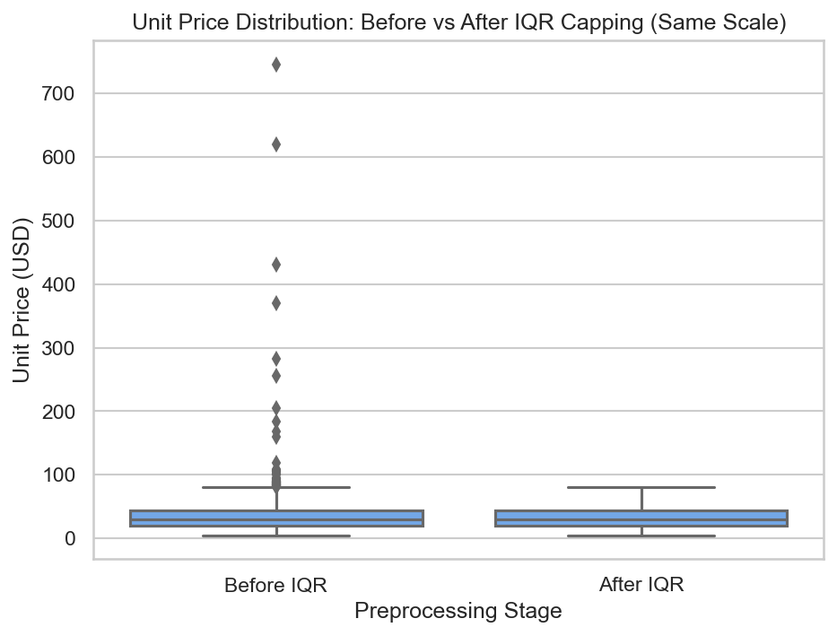
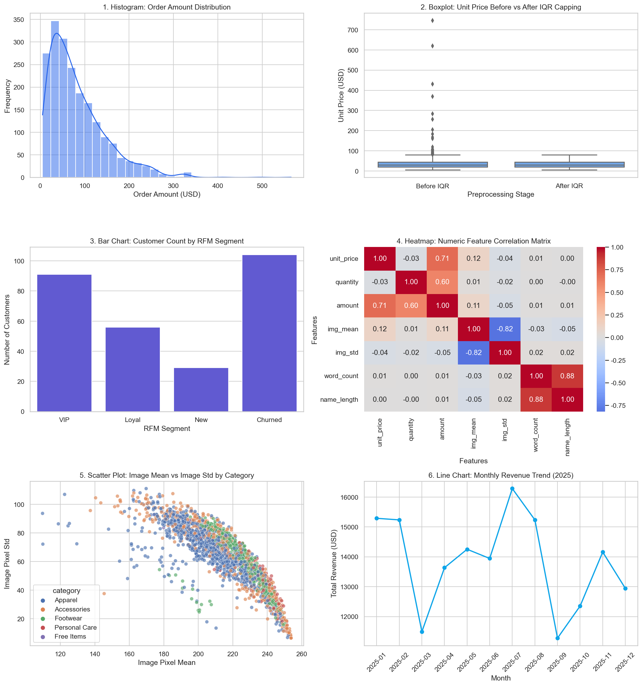

# codyssey-a1-01: 이커머스 멀티모달 데이터 분석 및 RFM 고객 세분화

쇼핑몰에서 누가 자주 오고 많이 사는지 분석해 단골을 찾고, 상품 텍스트·이미지·수치·날짜 멀티모달 데이터를 NumPy/Pandas 기반으로 통합 전처리·시각화하는 프로젝트입니다.

---

## 📊 데이터셋 안내 (출처 및 구성)

본 프로젝트는 공개 라이선스 데이터셋을 기반으로 멀티모달 이커머스 분석 환경을 구성했습니다.

1. **원본 상품 카탈로그 및 이미지 (실제 공개 데이터)**
   * **출처**: Hugging Face [`ashraq/fashion-product-images-small`](https://huggingface.co/datasets/ashraq/fashion-product-images-small) (Kaggle *Fashion Product Images* 기반, 공개 카탈로그)
   * **포함 컬럼**: `product_id`, `product_name`, `gender`, `category`, `sub_category`, `base_colour`, `season`, `year`, 및 각 상품에 1:1 대응하는 실제 RGB 이미지(`(80, 60, 3)`, `uint8`)
2. **거래·RFM 분석용 보강 컬럼 (합성 결합 데이터)**
   * 원본 카탈로그 데이터셋에는 고객별 주문 이력이 포함되어 있지 않아, RFM 분석 및 시계열 EDA 수행을 위해 `scripts/prepare_dataset.py`를 통해 다음 거래 컬럼을 결합했습니다.
   * **결합 컬럼**: `customer_id`(고유 고객 280명), `order_date`(2025-01-01 ~ 2025-12-31), `unit_price`(카테고리별 가격 분포), `quantity`, `amount`
   * **전처리 실습용 데이터**: `unit_price`/`amount` 결측치 50건 및 가격·수량 이상치 30건 포함
3. **생성된 로컬 데이터 파일**
   * `data/ecommerce_transactions.csv`: 2,000건 × 14개 컬럼
   * `data/product_images.npy`: `(2000, 80, 60, 3)` NumPy 배열 (`image_id`로 CSV 행과 1:1 매칭)

---

## 🏗️ 아키텍처 및 API 명명 규칙

* **핵심 모듈**: `src/pipeline.py` (`DataAnalyzer` 클래스)
  * `load_data()`: CSV 및 `.npy` 이미지 배열 로드
  * `extract_multimodal_features()`: NumPy 벡터 연산 기반 이미지 통계(`img_mean`, `img_std`, `img_downsampled_mean`) 및 텍스트 피처(`name_length`, `word_count`) 추출 — 연속 메모리(C-order) 배치와 **CPU SIMD(SSE/AVX2/NEON) 벡터 명령어 하드웨어 가속**을 통해 Python `for` 루프의 타입 검사·박싱 오버헤드 없이 다수 픽셀을 병렬 연산합니다([NumPy SIMD 문서](https://numpy.org/doc/stable/reference/simd/index.html)).
  * `handle_missing_values()` / `handle_missing()` *(별칭)*: `코디세이 a1-1.md`의 `handle_missing_values()`와 평가 규격의 `handle_missing()` 모두 호환되도록 동일 메서드 별칭 제공
  * `detect_outliers()`: IQR(`Q3 - Q1`) 기반 이상치 탐지 및 Capping/제거
  * `compute_statistics()`: 평균, 중앙값, 표준편차, 사분위수(Q1/Q2/Q3) 및 상관계수 행렬 산출
  * `calculate_rfm()`: RFM 점수화(`VIP`, `Loyal`, `New`, `Churned`)
* **시각화 모듈**: `src/visualize.py` (6종 EDA 차트 및 이상치 처리 전후 박스플롯 생성)


---

## 📈 시각화 결과 및 노트북 실행 증거

### 노트북 및 시각화 실행 로그
`notebooks/analysis_report.ipynb` (17셀 전체 실행 완료) 및 `src/visualize.py` 실행 결과:
```text
$ python scripts/build_notebook.py
Executed & saved notebooks\analysis_report.ipynb (17 cells)

$ python src/visualize.py
Saved: diagrams\outlier_boxplot_comparison.png
Saved: diagrams\eda_6_charts.png
```

### 이상치 처리 전후 비교 (동일 스케일 박스플롯)


### 필수 EDA 시각화 6종 (제목 및 축 레이블 포함)


---

## 🔬 통계적 방법론 및 대규모 처리 한계·개선안

### 1. IQR 이상치 탐지의 장점 및 비대칭 분포 한계
* **장점(Robustness)**: 평균과 표준편차를 사용하는 Z-score 방식은 극단값 자체가 평균·표준편차를 끌어올려 탐지력이 떨어지는 반면, IQR(`Q3 - Q1`)은 중앙값과 사분위수 기반이므로 극단치에 강건(Robust)합니다.
* **비대칭(Skewed) 분포에서의 한계**: 이커머스 거래 금액(`amount`)이나 단가(`unit_price`)처럼 오른쪽 꼬리가 긴(Right-skewed) 분포에서는 정상적인 고가 주문까지 상한(`Q3 + 1.5 * IQR`)을 초과해 이상치로 과잉 탐지될 수 있습니다. 실무에서는 로그 변환(`np.log1p`) 후 IQR을 적용하거나 도메인 가격 상한 정책을 병행해야 합니다.

### 2. GroupBy 결측치 대치의 통계적 위험
* **그룹 내 분산 축소(Variance Shrinkage)**: 카테고리별 결측치를 모두 동일한 대표값(중앙값/평균)으로 대치하면 실제 가격 변동성이 사라져 그룹 내 표본 분산과 표준편차가 인위적으로 작아집니다.
* **그룹 간 차이 과장 및 상관 왜곡**: 예를 들어 `Personal Care` 카테고리의 결측치들을 모두 단일 중앙값(`$18.0`)으로 채우면, 해당 그룹 내부의 분산이 줄어들면서 다른 카테고리(`Footwear` 등)와의 평균 차이가 실제보다 과장되어 보일 수 있습니다.

### 3. 대규모 이미지 처리 병목 지점 및 개선 방안
* **병목 지점**:
  1. **디스크 I/O**: 수십만 장의 개별 JPEG/PNG 파일을 매번 열어 디코딩할 때 랜덤 I/O 지연이 발생합니다.
  2. **메모리 적재(RAM)**: 전체 이미지를 한 번에 4D `uint8`/`float32` 텐서로 메모리에 올리면 OOM(Out-Of-Memory) 위험이 있습니다.
  3. **전처리 연산**: 고해상도 이미지 전체 픽셀 통계 계산 시 CPU 캐시 미스가 증가합니다.
* **개선 방안**:
  * `np.memmap` 또는 Parquet/NPY 샤딩 기반 **미니배치(Batch) 스트리밍 처리**
  * `concurrent.futures.ProcessPoolExecutor`를 활용한 **이미지 디코딩·통계 추출 병렬화**
  * 탐색/학습 단계에서 `arr[:, ::n, ::n, :]` **스트라이드 다운샘플링(Subsampling)**으로 메모리와 연산량을 $n^2$배 절감

---

## 💡 비즈니스 인사이트 (근거 · 실행 · 검증) & 우선 KPI 기준

### 우선 액션 세그먼트 선정 KPI 기준
우선순위 산정 시 다음 4가지 KPI를 우선 고려했습니다:
1. **매출 기여도(Revenue Share)**: 총매출 방어 효과 (`VIP` 최우선)
2. **이탈 위험도(Recency 경과일) 및 모수 규모**: 단기 회수 가능성 (`Churned` 37.1%)
3. **객단가 및 구매 빈도(ARPU / Frequency)**
4. **캠페인 ROI(전환율 대비 쿠폰 비용)**

### 인사이트 1. 상위 VIP 고객군의 매출 집중과 락인(Lock-in) 전략
* **(근거)** RFM 분석 결과 **VIP** 세그먼트는 전체 고객 280명 중 `91명(32.5%)`이지만, 평균 구매 빈도 `14.48회`, 평균 구매 금액 `$1,212.75`로 핵심 매출을 견인하고 있습니다.
* **(실행)** `VIP` 세그먼트를 대상으로 분기별 신상품(`Apparel`, `Footwear`) 얼리 액세스 및 무료 배송 멤버십을 제공하여 이탈을 방지하고 객단가를 유지합니다.
* **(검증)** 본 데이터는 주문 로그를 결합한 구조이므로, 실제 운영 적용 전 쿠폰 사용률 및 반품률 데이터를 추가 수집하여 VIP 순이익(마진) 기여도를 재검증해야 합니다.

### 인사이트 2. 최대 비중을 차지하는 이탈(Churned) 고객 재활성화
* **(근거)** **Churned** 세그먼트는 `104명(37.1%)`으로 가장 많은 인원을 차지하며, 평균 최근 구매 경과일(Recency)이 `181.38일`, 평균 구매 빈도가 `2.04회`로 정체되어 있습니다.
* **(실행)** `Churned` 세그먼트 중 과거 `Footwear`·`Accessories` 구매 이력이 있는 고객을 대상으로 15% 복귀 할인 쿠폰 푸시 및 개인화 리마인드 이메일을 발송합니다.
* **(검증)** 이메일 오픈율/클릭률(CTR) 및 대조군(쿠폰 미발송 그룹) 대비 재구매 전환율 차이를 A/B 테스트로 측정해 단순 자연 복귀 가설을 반증·검증할 필요가 있습니다.

### 인사이트 3. 이미지 시각적 특성(`img_mean`·`img_std`)과 가격대·카테고리 연계
* **(근거)** NumPy 벡터 연산으로 추출한 이미지 밝기 평균(`img_mean`)과 표준편차(`img_std`) 간 상관계수는 `r = -0.818`로 강한 음의 상관을 보이며, 밝은 단색 배경의 스튜디오 컷일수록 픽셀 편차가 작고 `unit_price`와 `amount`의 상관(`r = 0.707`)이 높게 나타납니다.
* **(실행)** `New` 세그먼트(`29명`, 평균 Recency `20.48일`) 대상 첫 재구매 유도 배너에 배경이 깔끔하고 대비가 뚜렷한 고단가(`Footwear`/`Accessories`) 대표 썸네일을 우선 노출해 클릭률과 장바구니 단가를 높입니다.
* **(검증)** 썸네일 스타일별 실제 상세페이지 진입률(CTR)과 장바구니 전환 데이터가 없으므로, 이미지 밝기/대비가 매출에 직접 인과를 미치는지 실험 로그로 추가 검증해야 합니다.

---

## 🤖 머신러닝(ML) 확장 설계 (예상 타겟 및 권장 피처)

본 전처리·RFM 파이프라인의 산출물은 후속 지도학습 모델로 바로 확장할 수 있습니다.

* **예상 예측 타겟(Target)**:
  1. `is_churned` (이진 분류): 기준일 이후 90일 내 재구매 여부 / 이탈 예측
  2. `next_purchase_amount` / `LTV` (회귀): 고객별 향후 예상 구매액(생애가치) 예측
* **권장 입력 피처(Features)**:
  * **RFM 파생 피처**: `Recency`, `Frequency`, `Monetary`, `R_score`, `F_score`, `M_score`, `RFM_score`
  * **이미지 멀티모달 피처**: `img_mean`, `img_std`, `img_downsampled_mean`
  * **텍스트·카탈로그 피처**: `word_count`, `name_length`, `category`, `sub_category`, `gender`, `season`

---

## 🚀 실행 방법

```bash
# 1. 단위 테스트 실행 (Mock/임시파일 기반, < 0.2초)
python -m unittest discover -s tests -v

# 2. 시각화 6종 및 박스플롯 비교 PNG 생성
python src/visualize.py

# 3. 분석 노트북 실행 및 저장
python scripts/build_notebook.py
```

---

## ✅ 평가자용 원클릭 요구사항 검증 가이드

아래 명령어를 실행하면 과제 명세서(`코디세이 a1-1.md`)의 모든 핵심 조건(데이터 규모, 멀티모달 피처, 결측치/이상치 처리, RFM 4개 세그먼트, 금지 라이브러리 미사용, 상대경로 준수)을 한 번에 검증하고 JSON 요약을 출력합니다.

```bash
python scripts/verify_requirements.py
```

### 예상 콘솔 및 JSON 출력 예시
```text
================================================================
codyssey-a1-01 Evaluator Requirement Verification
================================================================
  [PASS] rows_ge_1000
  [PASS] cols_ge_8
  [PASS] images_4d_numpy
  [PASS] missing_imputed
  [PASS] outliers_handled
  [PASS] rfm_segments_ge_4
  [PASS] no_forbidden_imports
  [PASS] relative_md_images
----------------------------------------------------------------
{
  "status": "PASS",
  "elapsed_sec": 0.3995,
  "dataset_rows": 2000,
  "dataset_cols": 14,
  "image_shape": [2000, 80, 60, 3],
  "outliers_capped": {
    "unit_price": 49,
    "quantity": 15
  },
  "corr_img_mean_std": -0.818,
  "corr_word_name_len": 0.8849,
  "rfm_segments": {
    "Churned": 104,
    "VIP": 91,
    "Loyal": 56,
    "New": 29
  }
}
================================================================
```
